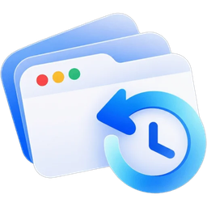
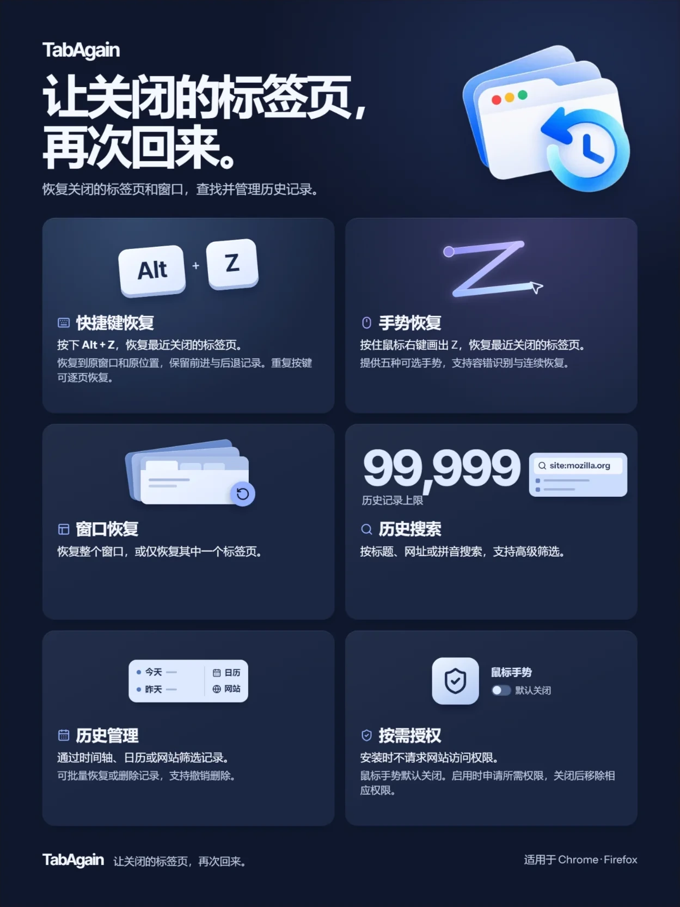

<div align="center">



# TabAgain

**Bring closed tabs back.**

[简体中文](README.md) · English

[](LICENSE)


</div>

<p align="center">
  
</p>

## Overview

TabAgain is a browser extension that reopens closed tabs and windows, and helps you find and manage their history.

Press a shortcut and the tab you just closed returns to its original window and position, along with its Back and Forward history. All records stay on your device.

## Features

| | |
| --- | --- |
| **Keyboard Shortcut** | Press `Alt` `Z` to reopen the last closed tab in its original window and position, with its Back and Forward history. Press again to keep going. |
| **Mouse Gestures** | Hold the right mouse button and draw a Z. Choose from five gestures, with forgiving recognition and repeat gestures to reopen several tabs. Off by default. |
| **Window Restore** | Closed windows are recorded as a whole. Reopen the entire window, or just one of its tabs. |
| **History Search** | Search by title, URL, or pinyin, with `site:`, excluded words, and date filters. Keeps up to 99,999 records. |
| **History Management** | Browse by timeline, calendar, or site. Select multiple records to reopen or delete them at once, and undo a deletion. |
| **On-Demand Permissions** | No website access is requested at install. It’s requested only when you turn on mouse gestures, and released when you turn them off. |

TabAgain also supports light and dark appearance, and is available in English, Simplified Chinese, and Traditional Chinese.

## Installation

### Chrome, Edge, and other Chromium browsers (120 or later)

1. Download this repository (**Code → Download ZIP**) and unzip it, or use `git clone`.
2. Open `chrome://extensions` and turn on **Developer mode** in the upper-right corner.
3. Click **Load unpacked** and select the `src` folder in the repository.

### Firefox (140 or later)

1. In the repository root, run `python3 tools/build.py` to create `dist/TabAgain-1.0.0-firefox.xpi`.
2. Open `about:debugging#/runtime/this-firefox`, click **Load Temporary Add-on**, and select the file.

> Temporary add-ons are removed when Firefox restarts. For everyday use, install a version signed by Mozilla.

## Usage

### Keyboard Shortcut

| Action | Default Shortcut |
| --- | --- |
| Reopen Last Closed Tab | `Alt` `Z` |

If the shortcut conflicts with another extension, change it at `chrome://extensions/shortcuts`. In Firefox, open the Add-ons Manager, click the gear menu, and choose Manage Extension Shortcuts.

### Mouse Gestures

Turn on **Mouse Gestures** in Settings. Your browser asks for website access; once you allow it, gestures are ready to use.

- **Windows:** Hold the right mouse button and draw.
- **macOS:** Hold `Option` and draw with the left button. **Linux:** Hold `Alt` and draw with the left button. On these systems, pressing the right button opens a menu right away, so a modifier key is used instead.
- **Gestures:** Z shape (default), Left then Up (←↑), Right then Left (→←), Up then Left (↑←), and Down then Right (↓→). Choose one in Settings and practice in the Try It area.
- **Repeat:** Draw two Zs within a second to reopen two tabs.
- **Sites without gestures:** Common map and design tools, such as Google Maps and Figma, are included by default. You can add or remove sites.

Gestures aren’t available on browser pages, extension stores, the New Tab page, or the PDF viewer.

### Search Syntax

| Query | Meaning |
| --- | --- |
| `github issue` | Matches records that contain every word |
| `zhihu` or `zh` | Full pinyin or initials, for Chinese titles |
| `site:github.com` | Shows one site, including its subdomains |
| `-login` | Excludes records that contain the word |
| `today` `yesterday` `week` `month` | Filters by date |

## Privacy and Permissions

TabAgain doesn’t collect or upload any data. Records are stored locally in your browser’s IndexedDB and are deleted when you remove the extension.

| Permission | Purpose |
| --- | --- |
| `tabs`, `sessions` | Record closed tabs and fully restore them through the browser session |
| `storage`, `unlimitedStorage` | Store settings and history on your device |
| `alarms` | Remove expired records once a day |
| `favicon` | Show site icons (Chrome only) |
| `tabGroups` | Return restored tabs to their original tab group (Chrome only) |
| `scripting` | Register the gesture script on webpages after you turn on mouse gestures |
| Website access (optional) | Requested only when you turn on mouse gestures. The script listens to mouse movement and never reads page content |

## Building from Source

Requires Python 3.

```bash
python3 tools/build.py
```

This creates:

- `dist/TabAgain-1.0.0-chrome.zip` for the Chrome Web Store
- `dist/TabAgain-1.0.0-firefox.zip` and `.xpi` for Firefox Add-ons

Other tools:

| Script | Purpose |
| --- | --- |
| `tools/messages.py` | The interface strings for all three languages; writes `src/_locales` |
| `tools/icons.py` | Generates extension icons and store assets from `assets/logo-source.webp` (requires Pillow) |
| `tools/onboarding_lottie.py` | Generates the Lottie animation for the welcome guide |

## Project Structure

```
src/
├── manifest.json
├── background.js        Background: recording, restoring, cleanup
├── popup/               Toolbar popup
├── history/             History page
├── options/             Settings and the welcome guide
├── gesture/             Gesture recognition and the page script
├── shared/              Database, search, UI components, settings
├── onboarding/          Welcome animation
├── _locales/            zh_CN · en · zh_TW
├── icons/
└── vendor/              lottie-web (MIT)
tools/                   Build and generation scripts
assets/                  Icon source and store assets
docs/                    README images
```

## License

TabAgain is released under the [GNU General Public License v3.0](LICENSE).

The bundled [lottie-web](https://github.com/airbnb/lottie-web) is released under the MIT License. See `src/vendor/lottie-LICENSE.md`.
