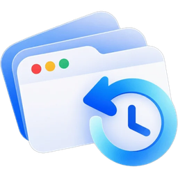
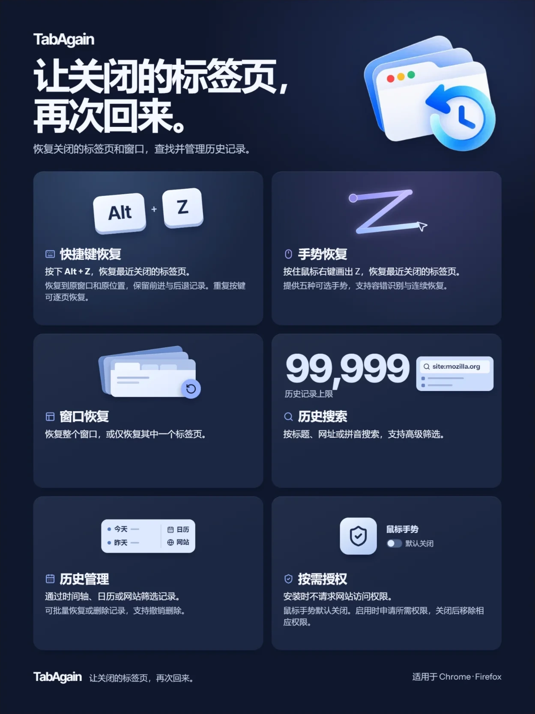

<div align="center">



# TabAgain

**让关闭的标签页，再次回来。**

简体中文 · [English](README.en.md)

[](LICENSE)


</div>

<p align="center">
  
</p>

## 简介

TabAgain 是一个浏览器扩展，用来重新打开关闭的标签页和窗口，并查找、管理它们的历史记录。

按下快捷键，刚关闭的标签页就会回到原来的窗口和位置，前进与后退记录也一并保留。所有记录只保存在你的设备上。

## 功能

| 功能 | 说明 |
| --- | --- |
| **快捷键恢复** | 按 `Alt` `Z` 重新打开上次关闭的标签页。回到原窗口、原位置，保留前进与后退记录。连续按下可逐个恢复。 |
| **鼠标手势** | 按住右键画一个 Z 即可恢复。提供五种手势，识别宽容，可连画恢复多个。默认关闭。 |
| **窗口恢复** | 关闭整个窗口时整体记录。可重新打开整个窗口，也可只打开其中一个标签页。 |
| **历史搜索** | 按标题、网址或拼音搜索，支持 `site:`、排除词和日期筛选。最多保存 99,999 条记录。 |
| **历史管理** | 按时间轴、日历或网站浏览。可多选后批量重新打开或删除，删除后可撤销。 |
| **按需授权** | 安装时不请求任何网站访问权限。只有打开鼠标手势时才申请，关闭后随即交还。 |

此外还支持浅色与深色外观，界面提供简体中文、繁體中文和 English。

## 安装

从 [Releases](https://github.com/cocang/TabAgain/releases/latest) 下载对应浏览器的安装包。

| 浏览器 | 安装包 |
| --- | --- |
| Chrome、Edge 及其他 Chromium 浏览器（120 及以上） | `TabAgain-1.0.0-chrome.zip` |
| Firefox（140 及以上） | `TabAgain-1.0.0-firefox.xpi` |

### Chrome、Edge 及其他 Chromium 浏览器

1. 下载 `TabAgain-1.0.0-chrome.zip` 并解压到一个固定位置。
2. 打开 `chrome://extensions`，开启右上角的 **开发者模式**。
3. 点 **加载已解压的扩展程序**，选择解压出的文件夹。

> 加载后请保留这个文件夹，删除或移动它会导致扩展失效。

### Firefox

1. 下载 `TabAgain-1.0.0-firefox.xpi`。
2. 打开 `about:debugging#/runtime/this-firefox`，点 **临时载入附加组件**，选择下载的文件。

> 临时载入的附加组件会在 Firefox 重新启动后移除。长期使用请安装经 Mozilla 签名的版本。

如需从源码安装，请参阅 [从源码构建](#从源码构建)。

## 使用

### 快捷键

| 操作 | 默认快捷键 |
| --- | --- |
| 重新打开上次关闭的标签页 | `Alt` `Z` |

如果快捷键与其他扩展冲突，可在 `chrome://extensions/shortcuts`（Firefox：附加组件管理器 → 齿轮菜单 → 管理扩展快捷键）中更改。

### 鼠标手势

在设置中打开 **鼠标手势**，浏览器会询问网站访问权限，同意后即可使用。

- **Windows**：按住右键画。
- **macOS**：按住 `⌥` 用左键画。**Linux**：按住 `Alt` 用左键画。这两个系统按下右键就会弹出菜单，因此改用修饰键。
- **手势**：Z 形（默认）、左上（←↑）、右左（→←）、上左（↑←）、下右（↓→），可在设置中选择，并在「试一试」区域练习。
- **连画**：1 秒内连画两个 Z，会重新打开两个标签页。
- **不使用手势的网站**：默认包含常见的地图和设计工具（如 Google 地图、Figma），可自行增删。

手势在浏览器内部页面、扩展商店、新标签页和 PDF 阅读器中不可用。

### 搜索语法

| 写法 | 含义 |
| --- | --- |
| `github issue` | 同时包含所有关键词 |
| `zhihu` 或 `zh` | 拼音全拼或首字母 |
| `site:github.com` | 只看某个网站（含子域名） |
| `-login` | 排除包含该词的记录 |
| `今天` `昨天` `前天` `本周` `本月` | 按日期筛选（也可用 `today` `yesterday` `week` `month`） |

## 隐私与权限

TabAgain 不收集、不上传任何数据。记录保存在浏览器本地的 IndexedDB 中，删除扩展即一并删除。完整说明见[隐私政策](PRIVACY.md)。

| 权限 | 用途 |
| --- | --- |
| `tabs`、`sessions` | 记录关闭的标签页，并通过浏览器会话完整恢复 |
| `storage`、`unlimitedStorage` | 在本地保存设置与历史记录 |
| `alarms` | 每天清理过期记录 |
| `favicon` | 显示网站图标（仅 Chrome） |
| `tabGroups` | 恢复时回到原来的标签页分组（仅 Chrome） |
| `scripting` | 打开鼠标手势后，在网页中注册手势脚本 |
| 网站访问（可选） | 仅在打开鼠标手势时申请。脚本只监听鼠标动作，不读取网页内容 |

## 从源码构建

需要 Python 3。

```bash
python3 tools/build.py
```

生成以下文件：

- `dist/TabAgain-1.0.0-chrome.zip`：用于 Chrome 应用商店
- `dist/TabAgain-1.0.0-firefox.zip` 和 `.xpi`：用于 Firefox 附加组件商店

其他工具：

| 脚本 | 作用 |
| --- | --- |
| `tools/messages.py` | 三种语言的界面文案总表，运行后写入 `src/_locales` |
| `tools/icons.py` | 由 `assets/logo-source.webp` 生成扩展图标与商店素材（需要 Pillow） |
| `tools/onboarding_lottie.py` | 生成首次使用引导的 Lottie 动画 |

## 项目结构

```
src/
├── manifest.json
├── background.js        后台：记录、恢复、清理
├── popup/               工具栏弹出窗口
├── history/             历史记录页
├── options/             设置页与首次使用引导
├── gesture/             手势识别与网页内脚本
├── shared/              数据库、搜索、界面组件、设置
├── onboarding/          引导动画
├── _locales/            zh_CN · en · zh_TW
├── icons/
└── vendor/              lottie-web（MIT）
tools/                   构建与生成脚本
assets/                  图标源文件与商店素材
docs/                    README 图片
```

## 许可

TabAgain 以 [GNU General Public License v3.0](LICENSE) 发布。

内置的 [lottie-web](https://github.com/airbnb/lottie-web) 以 MIT 许可发布，见 `src/vendor/lottie-LICENSE.md`。
